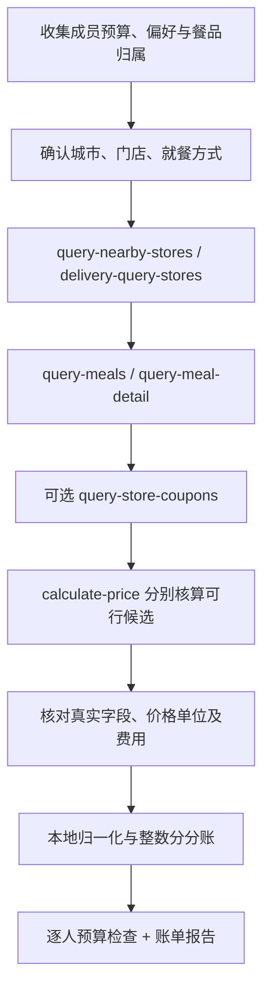

# 麦当劳 MCP 接入与业务流程

## 服务与凭证

- 官方 Server：`https://mcp.mcd.cn`，Streamable HTTP。
- 本项目依赖宿主 AI 客户端已连接的麦当劳 MCP，不需要再部署一个服务端。
- 使用 `mcp-config.example.json` 时，将环境变量占位符在支持该语法的客户端中解析。客户端若不支持变量插值，在其本地连接器设置里安全填入，勿将实际值保存或提交至仓库。
- 不读取、导出或传播 WorkBuddy 已保存的凭证。

## 真实调用流程

| Tool | 输入来源 | 用途及业务价值 |
|---|---|---|
| now-time-info | 当前 MCP schema | 时间与报价新鲜度参照 |
| query-nearby-stores | 用户提供的城市/公共地点、取餐方式 | 确定真实可用门店，防止跨门店价格混用 |
| delivery-query-stores | 经授权的配送信息 | 外送可配送门店；本次到店测试不需要此工具 |
| query-meals | 门店返回编码与就餐方式 | 读取当前可售餐品与编码 |
| query-meal-detail | 菜单的实际商品编码 | 检查套餐、换配和必选项 |
| query-store-coupons | 同一门店和就餐方式 | 可选查询真实适用券，不能假设可叠加 |
| calculate-price | 实际购物车、可行优惠 | 核对官方应付与费用，给分账提供真实依据 |
| campaign-calendar | 当前日期，可选 | 活动参考，不把活动宣传价当成购物车核价 |

完整参数约束见 Skill 的 references/mcp-workflow.md。客户端命名空间因安装方式变化，当前 schema 是最终依据。

## 归一化契约和金额

`src/split.mjs` 只接受本地标准化输入，不会自行联网。宿主必须依据真实响应确认行金额是否已包含优惠，避免把同一优惠扣两次。未知金额不补零；未拆分费用不可忽略。真实输入必须记录工具、门店、方式、报价时间与本地证据引用，仍须对照客户端调用记录核验来源。

输入输出均为人民币整数分。共享行、整单优惠、费用各自用最大余数法分摊，且严格校验金额守恒。报告不会把分账结果当作已创建订单或已收款。

## 验证范围

连通性与真实点餐核价由 WorkBuddy 中用户已有的 MCP 连接器执行；实际完成的调用和结果见 `docs/live-validation.md` 与 `workbuddy.md`。这些文件记录的是实际验证范围，不能把工具 schema 可见性等同于真实调用成功。

离线演示和边界测试使用模拟数据；它们只能证明本地分账和报告行为。外送地址、复杂套餐换配、多券叠加、预约、付费会员卡等未实测场景不得据此宣称已通过验证。

## 执行边界

本项目交付到试算和分账。不会自动调用 create-order、mall-create-order、party-order-create、auto-bind-coupons、draw-lottery，也不会支付、领券或扣积分。用户日后另行要求下单时须重新核价并按明确授权处理。

普通餐品多人点餐不使用派对预约工具。不存在公共“跨账号拼单链接 API”的假设。
