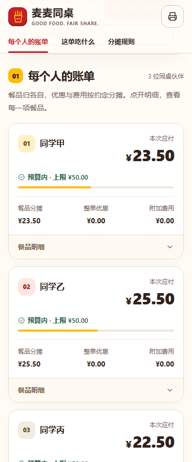
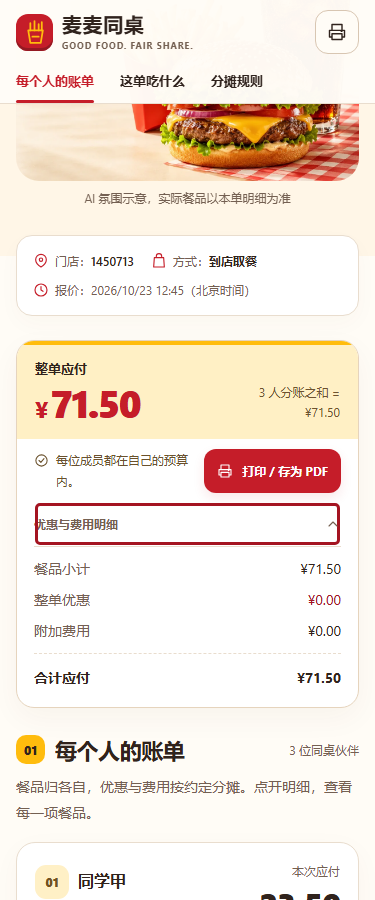
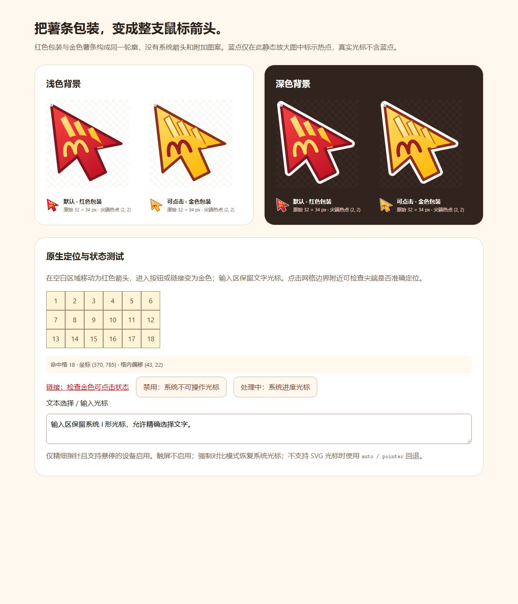

# 视觉精修：品牌光标与整页体验

本轮基于用户对上一版美观度的反馈，继续使用已安装的 UI/UX Pro Max、Product Design 和现有 Remotion；保留报价、分账和分享打印流程。没有新增订单或支付模块。

## 从实际页面发现并修正的问题

| 上一版问题 | 当前实现 |
|---|---|
| 系统箭头旁附一枚小薯条，整体没有品牌感 | 原生指针本体变为完整薯条包装箭头，三根金黄薯条和双拱门式 M 融入同一轮廓；红色默认、金色可点击，两态共用尖端和热点 |
| 首屏不规则图片轮廓与账单区衔接生硬 | 食物主视觉改为规整圆角构图，门店、方式与时间整合成衔接首屏的订单信息条 |
| 手机汇总卡过高、重复信息占据主流程 | 使用紧凑总额卡；费用明细默认折叠，支持 Enter 展开，打印会自动包含完整明细 |
| 个人卡大量重复竖向信息 | 手机将身份和应付金额并排；餐品、优惠、费用以三列列出，不删除金额；预算与展开入口保持清楚 |
| 文字尺度过碎、明细偏小 | 统一标题、正文与辅助层级；规则和明细提升到14px，分项标签至少12px，中文标题字距放松 |
| 卡片表面缺少区分 | 个人账单用票据分隔、餐品用奶油托盘表面、汇总用浅金色、规则用安静纸面、分享使用明确红色主按钮 |
| 平板首屏与手机商品图裁切偏紧 | 平板恢复完整3:2套餐构图；手机商品图采用 contain，保留汉堡完整轮廓 |
| 导航定位空白偏多 | 消除 scroll-padding 与 scroll-margin 的重复偏移；375×900 模拟视口跳转后可完整阅读两张成员卡 |

## 光标并非跟随装饰层

SVG 为 **32×34px**，尖端热点 **(2,2)**。默认和可点击态具有完全相同的外轮廓，切换时不改变指针位置；外围浅色描边和内部深色轮廓适配深浅背景。采用浏览器原生 CSS cursor，没有隐藏系统光标后再用 DOM 跟随，没有额外鼠标移动循环。

链接、按钮和三种展开入口均使用金色可点击状态。输入保留文本光标，禁用/忙碌显示系统状态；触屏不启用，强制颜色模式恢复系统光标。不支持 SVG 光标时回退系统 auto/pointer。

可打开 [实际可交互光标检视页](ui/cursor-preview.html)，将指针移到空白、链接、按钮和输入区查看状态；该页还展示原尺寸和放大后的同源 SVG。

检视图展示的是同源矢量素材；无头浏览器截图不包含操作系统原生指针，不能据此宣称已验证所有系统缩放及实体鼠标环境。

## 验证与边界

原有52项本地测试通过。当前 **62项浏览器检查全通过**，其中保留原50项业务、布局、键盘、复制、打印、减少动态效果等检查，新增手机费用展开、14px明细、同屏成员卡、品牌光标状态及级联覆盖。最后一项明确核对16个链接、按钮、展开入口均为金色可点击光标，排除局部 cursor:pointer 样式覆盖。结果见 [browser-checks.json](ui/browser-checks.json)。

独立光标检视另有44项检查，包含同一轮廓、热点、颜色状态、SVG解码、强制颜色和网格边界命中；结果见 [cursor-checks.json](ui/cursor-checks.json)。此组与整页检查存在覆盖，不累加为独立用例总数。

三人样例仍为一页A4，金额、明细、规则和页脚完整。没有外部图片/字体/脚本请求或页面运行时错误。系统减少动态效果偏好继续有效；Remotion 4.0.534 新增220ms的真实明细展开反馈，动效包31,699字节，包含许可说明。

本轮在 Windows Chrome 独立配置中检查，手机和平板采用视口/触摸模拟；实体设备、Safari、Firefox、读屏器与真实打印机未验证。没有重新调用实时MCP；71.50元仍是之前的报价快照。

## 使用的工具

UI/UX Pro Max 用于字号、信息密度、交互和可访问性检查；已通过 GitHub 插件核对[来源仓库](https://github.com/nextlevelbuilder/ui-ux-pro-max-skill)，2026-10-23 读取到139,242个Star。Product Design 用于现有页面的截图审查与同视口修改前后对照。Remotion 使用项目已固定的4.0.534及其原包插值、缓动函数。本轮没有安装新Skill或增加页面运行依赖。
