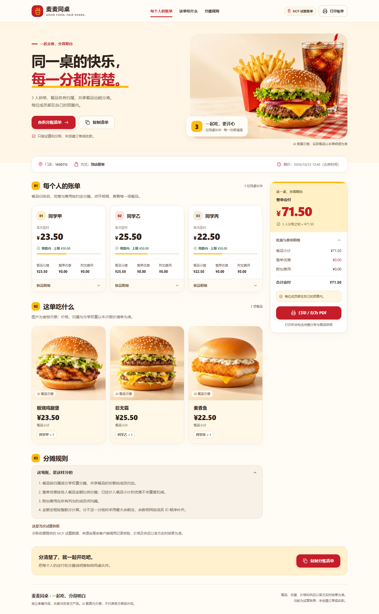
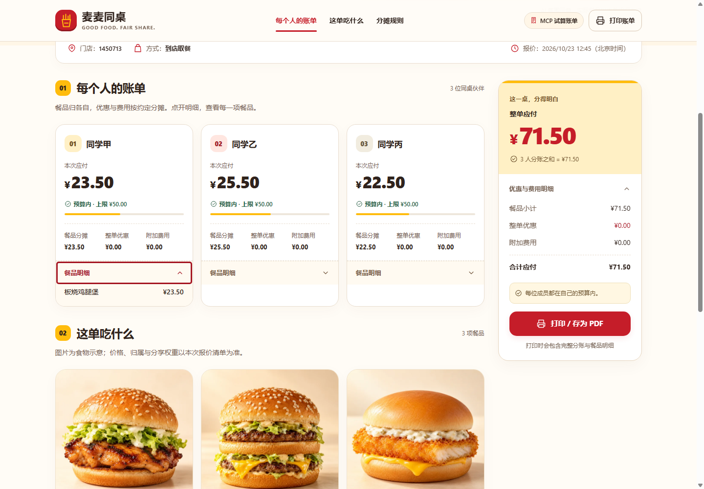
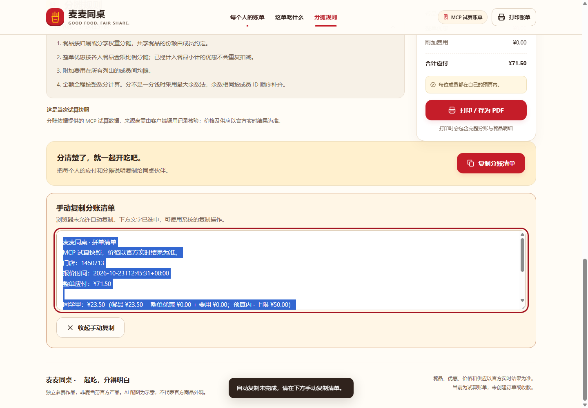

# 页面视觉与交互升级验收

升级对象为现有 HTML 拼单账单；保留门店、就餐方式、报价时间、个人应付、餐品归属、预算状态、优惠/费用和分摊规则。数据与分账算法不因视觉升级而改变。本次真实快照仍为 71.50 元，三人分别为 23.50、25.50、22.50 元。

## 按用户要求核对

| 要求 | 已落实的实现 | 核查依据 |
|---|---|---|
| 1. 品牌与层次 | 红色操作按钮、黄色强调、奶油白背景；主标题、总额、个人账单及辅助信息分级；卡片、留白、轻阴影；桌面侧边总额与移动端紧凑汇总；三列个人费用分项、托盘式餐品卡与安静纸面规则区 | 桌面和手机截图；多视口无溢出 |
| 2. 食物图片 | 内置模型生成聚餐主视觉、鸡腿堡、双层牛肉堡、鱼排堡四张图；统一暖光和奶油背景；WebP、正确比例和 alt；餐品图懒加载并预留空间 | 四张图解码成功；滚入后页面高度不变；资源清单含尺寸、字节数和哈希 |
| 3. 动效与反馈 | 实际 Remotion 插值与缓动；首屏 480/560ms，按钮 180ms、明细箭头 200ms、展开内容 220ms、卡片 240ms；复制的加载/成功/失败和打印状态对应实际行为 | 首屏中间帧、按钮悬停按下、明细展开、复制与打印路径；动画结束后无持续帧循环 |
| 4. 品牌鼠标 | 32×34 一体薯条包装箭头，热点 2,2；包装内嵌双拱门式 M；默认红色、全部可点击元素金色；精细指针专用，输入/禁用/忙碌与强制颜色保留系统提示 | 精细/触屏媒体条件、按钮/文本计算样式检查 |
| 5. 响应式与可访问性 | 320–1440px、手机横屏布局；主要目标至少 44px；可见文字按字号计算对比度；键盘焦点、语义标题、原生 details、跳转链接、状态播报；系统减少动态效果 | 多视口截图、键盘 Enter/Tab、焦点、正文对比度、减少动态效果首开及切换检查 |
| 6. 主动补齐 | 手动复制区立即显示并选中文字；复制后返回原按钮；打印前展开全部明细并还原；零优惠不显示负零；焦点框内收避免被卡片裁切；长昵称、大金额、未知预算及未知餐品类型有适当呈现；修正导航重复偏移、平板主图与手机餐品裁切 | 异常路径与 20 人压力数据；无页面运行时异常；独立 Skill 可输出完整离线 HTML |

图片为 AI 食物示意，页面已明确标注，不是官方商品摄影。无法可靠识别餐品类型时使用中性餐品图标，不套用不相干照片。没有增加订单、支付、邀请、营销等业务模块。

本轮针对美观与光标的进一步修订详见 [UI_REFINEMENT.md](UI_REFINEMENT.md)，含问题与实际修正对照、原尺寸光标检视和手机操作截图。

## Remotion 的实际接入

`motion/page-motion.mjs` 从 Remotion 导入 `interpolate` 和 `Easing`。构建器使用固定 **4.0.534** 包内原始辅助模块，避免公共入口附带的完整视频渲染器；原模块未被重写。浏览器帧时钟驱动现有语义 DOM，账单仍是 HTML。颜色与阴影使用轻量 CSS 过渡。

动效包 **31,699 字节**，包含第三方许可原文，没有 React/播放器运行时。代码只在实际过渡时请求动画帧；减少动态效果、进入打印或页面隐藏时结束非必要运动。首屏在脚本不可用时也保持可见。

四张 WebP 合计 **292,036 字节**；真实账单 HTML 约 **479KB**，图片与脚本内嵌，打开时无外部图片、字体或脚本请求。内嵌图片确保可迁移性；原生懒加载用于推迟下方餐品图的解码与展示，不能减少已内嵌在 HTML 中的字节。

## 操作路径与截图

本轮根据 Product Design 的检查方法沿现有查看、展开、分享路径检查；使用本地独立 Chrome，因为当前环境未提供可连接的内嵌浏览器实例。

1. **查看账单概览**：首屏主操作明确，门店和报价时间可查；手机以紧凑总额卡先展示应付金额，费用默认折叠、可由键盘或点击展开。通过 [桌面](ui/desktop.png) 与 [手机](ui/mobile.png) 截图检查，未见文字、图片或按钮重叠。
2. **展开个人餐品明细**：原生 summary 支持 Enter；箭头旋转与展开状态一致，金额和餐品归属可见。见 [明细展开](ui/details.png)。焦点框已调整到卡片内部，避免裁切。
3. **复制及失败回退**：真实浏览器复制内容与账单一致；权限拒绝时即时显示已选中的清单，收起后焦点返回按钮。见 [手动复制回退](ui/copy-fallback.png)。测试采用受控拒绝来覆盖异常路径，未改变任何客户端权限设置。

## 验证范围与限制

52 项本地测试通过。最终 **62 项浏览器检查通过**，结果见 [browser-checks.json](ui/browser-checks.json)，覆盖响应式、图片、实际动效、键盘、复制、打印和禁用 JavaScript 的阅读回退。示例打印为一页 A4，完整规则与明细可见；20 人账单允许合理分页，不承诺压缩成一页。

本轮没有重新调用实时 MCP，也没有创建订单、付款、发布仓库或提交报名。之前的真实调用证据见 [live-validation.md](live-validation.md)。浏览器检查使用 Windows 本机 Chrome 独立测试配置；手机为视口及触摸模拟，尚未验证实体手机、Safari、Firefox、读屏器或真实打印机。计算样式的文字对比度检查不能替代完整可访问性审计；未给出 Lighthouse 或真实设备帧率成绩。
